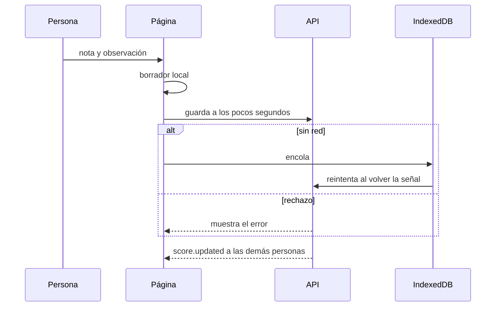

# Arquitectura de la web

React 18 con TypeScript y Vite. Se publica en Vercel como archivos estáticos.

## Carpetas

```text
src/
  main.tsx                arranque y enrutador
  app/                    marco, proveedores y páginas de error
  routes/                 una ruta por archivo, solo enlazan con su página
  routeTree.gen.ts        lo genera el enrutador: no se edita
  modules/<módulo>/
    domain/               tipos y reglas puras
    application/          consultas y contexto
    infrastructure/       llamadas a la API
    presentation/         páginas y componentes
  shared/
    api/                  cliente HTTP y sesión
    components/           componentes propios comunes
    ui/                   componentes básicos (Radix y Tailwind)
    design/               colores de puntaje
    i18n/                 textos en español e inglés
    lib/                  utilidades
    query/                fábrica de consultas
```

## Módulos

| Módulo | Qué contiene |
|---|---|
| `auth` | Sesión, acceso, usuarios, roles y proyectos |
| `assessment-core` | Organizaciones, panel, plan consolidado y componentes comunes |
| `indicator-tool` | Páginas genéricas de las herramientas por KPI |
| `organizational-tool`, `capacity-tool` | Definición de cada herramienta |
| `risk-tool` | Herramienta de Riesgos |
| `analytics` | Analítica y simulador |
| `realtime` | Avance en vivo y cola sin conexión |

## Rutas

| Ruta | Página |
|---|---|
| `/login` | Acceso |
| `/assessments` | Organizaciones |
| `/assessments/new`, `/assessments/:id/edit` | Registrar y editar |
| `/assessments/:id/action-plan` | Plan consolidado |
| `/assessments/associations/:id` | Panel de una asociación |
| `/assessments/dashboard`, `/assessments/analytics` | Panel y analítica |
| `/assessments/{organizational,capacity,risk}` | Panel de una herramienta |
| `…/:evaluationId` | Calificar |
| `…/:evaluationId/summary` | Resumen |
| `…/:evaluationId/action-plan`, `…/mitigation` | Plan |
| `…/:evaluationId/{dimension,area,principle}/:number` | Análisis de una sección |
| `…/admin` | Estructura |
| `/assessments/users`, `/assessments/organisations`, `/assessments/admin-global` | Administración |

`_loggedin.tsx` envía a `/login` a quien no tiene sesión.

## Estado

| Qué | Dónde |
|---|---|
| Datos del servidor | TanStack Query, con claves por herramienta y proyecto |
| Sesión, proyecto y roles | `auth-context.tsx` |
| Token de acceso | Memoria, en `session-token.ts` |
| Proyecto e idioma elegidos, borradores | `localStorage` |
| Calificaciones sin enviar | IndexedDB, en `offline-queue.ts` |
| Nombre destacado del encabezado | `page-header-context.tsx` |

## Llamadas a la API

Todo pasa por `shared/api/http-client.ts`. Ante un 401, `session-token.ts` renueva una
sola vez y repite la petición; las pestañas se turnan con Web Locks.

| Variable | Para qué |
|---|---|
| `VITE_API_URL` | Dirección de la API. Vacía usa el proxy `/api` |
| `VITE_AUTH_SAME_ORIGIN` | En `1`, la sesión va por el dominio de la web. La fija `vercel.json` |
| `VITE_GOOGLE_OAUTH_CLIENT_ID` | Acceso con Google |

## Calificar



## Diseño

- Colores y tipografía en `index.css` y `tailwind.config.js`. Cada herramienta tiene
  `--tool-organizational`, `--tool-capacity` o `--tool-risk`.
- Semáforo en `score-colors.ts`: rojo hasta 5, ámbar hasta 7, verde desde 7.
- Velocímetros, anillos y cronograma son SVG y CSS propios; las demás gráficas, recharts.
- Funciona en teléfono, tableta y escritorio.

## Textos

`shared/i18n/es.json` y `en.json`, con las mismas claves. `t("clave", { n: 1 })`
reemplaza las variables y `tr` admite `**negritas**`.

## Seguridad

Cabeceras en `vercel.json`: CSP, `X-Frame-Options`, `nosniff`, `Referrer-Policy` y
`Permissions-Policy`. Un servicio externo nuevo se agrega a la CSP. Los enlaces de
evidencia pasan por `webUrl`. Ocultar un menú no protege: protege el servidor.

## Compilación y pruebas

Cada ruta es un archivo aparte que se carga al visitarla. `npm test` corre las pruebas
junto al código (`*.test.ts`).

| Workflow | Qué hace |
|---|---|
| `ci.yml` | Convención, seguridad, estilo, comentarios, tipos, cobertura, mutación y compilación |
| `codeql.yml` | Análisis de código |
| `despliegue.yml` | Espera a Vercel y verifica página, rutas, sesión y cabeceras |

Cobertura mínima: 5,9 % sentencias, 5 % ramas y funciones, 6 % líneas. Es baja porque
las páginas no tienen pruebas; solo puede subir. Mutación mínima: cálculos 75 %,
sincronización 90 %, fechas 85 %.
